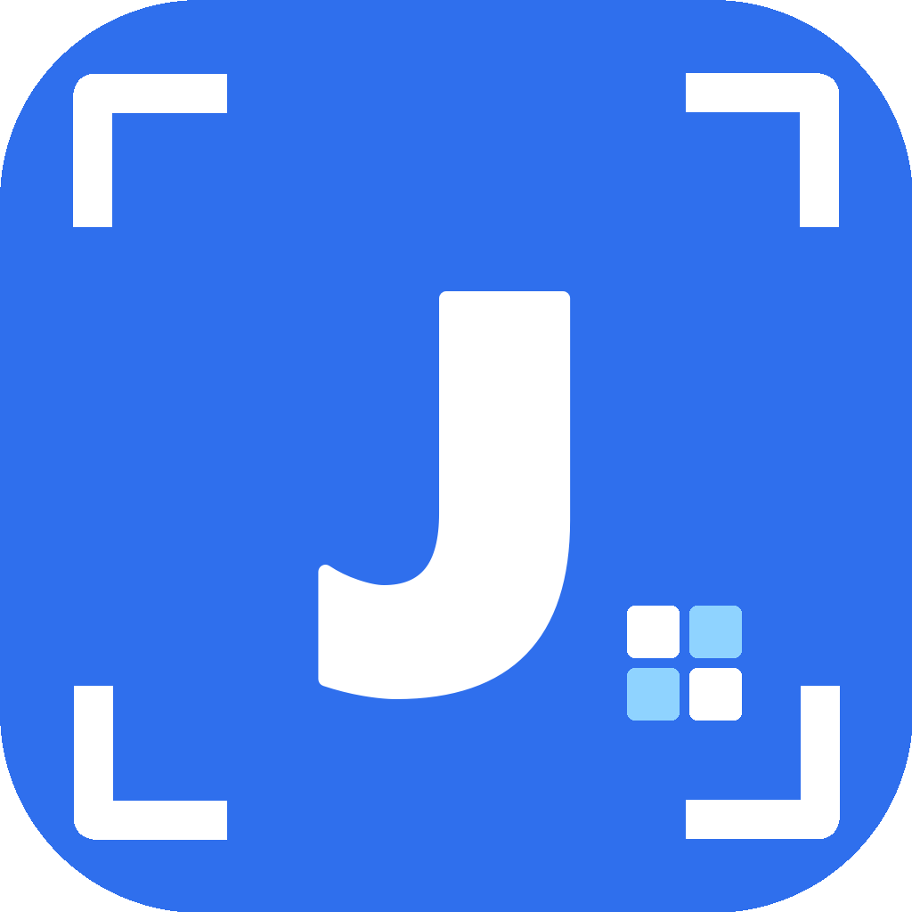

# Jpixel

<p align="center">
  
</p>

<p align="center">
  轻量、快速的 Windows 截图与贴图工具。
</p>

<p align="center">
  
  
  
</p>

---

## 简介

Jpixel 是一个面向 Windows 的轻量截图工具。

截图、框选、标注、贴图等高频操作全部由 **Rust + Win32/GDI/GDI+** 原生实现；Vue 只负责按需加载的设置界面。没有 WebView 截图遮罩，没有额外的渲染进程，启动和截图响应都更直接。

当前版本：**2.0.0**

- NSIS 安装包约 **1.27 MB**
- MSI 安装包约 **2.02 MB**
- 启动时默认不创建 WebView2，打开设置页时才加载

## 功能

### 截图

- 默认快捷键 `Alt+X` 唤起遮罩；
- 支持双击截图快捷键防误触，速度可调；
- 框选时显示尺寸与十字辅助线；
- 内置放大镜和取色笔，显示 HEX/RGB，按 `C` 复制颜色，可在设置中关闭；
- 支持重新框选、拖动选区、拖拽边角调整大小。

### 标注

- 左键画笔，右键橡皮；
- 滚轮切换画笔颜色，`Ctrl + 滚轮` 调整透明度；
- 橡皮支持多档大小，滚轮调整；
- 撤销 / 重做；
- 标注结果与截图一起复制或保存。

### 输出

- 一键复制到剪贴板；
- 保存为 PNG；
- 复制、保存、贴图均支持自定义遮罩内快捷键；
- 默认：复制 `Ctrl+C`，保存 `Ctrl+S`，贴图 `Ctrl+T`。

### 贴图

- 把选区贴到屏幕最上层；
- 按住左键拖动；
- 双击关闭；
- 滚轮缩放，目标步进 10%，最大 200%，140ms ease-out 平滑过渡，以鼠标位置为锚点；
- `Ctrl + 滚轮` 调整整窗透明度，范围 30%–100%；
- 中键恢复缩放和透明度到 100%；
- 贴图数量上限支持 2 / 4 / 6 / 8 张；
- 超过上限时从工具栏贴图图标弹出气泡，再次按贴图快捷键或左键点击托盘确认替换最早的一张。

### 托盘与设置

- 托盘常驻，右键菜单提供“设置 / 退出”；
- 托盘左键用于贴图上限确认；
- 设置页包含常规、快捷键、功能介绍；
- 设置窗口按需创建，关闭后隐藏复用；
- 支持开机自启、单实例运行。

## 技术架构

```text
┌─────────────────────────────────────────────┐
│                  Tauri 2                    │
│                                             │
│  Rust / Win32 原生层       Vue 3 设置层      │
│  ┌───────────────────┐    ┌──────────────┐  │
│  │ 截图遮罩           │    │ 设置页        │  │
│  │ 选区 / 工具栏      │    │ 功能介绍      │  │
│  │ 画笔 / 橡皮        │    │ 按需加载      │  │
│  │ 贴图窗口           │    └──────────────┘  │
│  │ 托盘 / 热键        │                      │
│  └───────────────────┘                      │
└─────────────────────────────────────────────┘
```

- **Rust**：截图、遮罩、GDI/GDI+ 绘制、全局热键、贴图窗口、托盘；
- **Tauri 2**：应用生命周期、单实例、设置页窗口；
- **Vue 3 + TypeScript + Vite**：设置界面；
- **Win32**：`RegisterHotKey`、`WS_EX_LAYERED`、`UpdateLayeredWindow`、GDI 双缓冲；
- **GDI+**：抗锯齿圆角工具栏、气泡、颜色预览。

### 关键目录

```text
src-tauri/
  src/
    overlay/       原生截图遮罩、选区、工具栏、标注
    pin.rs         原生贴图窗口（缩放/透明度/拖动）
    bubble.rs      贴图上限提示气泡
    config.rs      配置读写
    core/          截图、显示器、热键、几何等核心逻辑
  icons/           应用图标
src/
  views/Settings.vue   设置页
  api/ipc.ts           设置相关 IPC
assets/logo.png         Logo 源图
docs/                   测试用例与阶段记录
```

## 开发

### 环境

- Windows 10 / 11
- Node.js 18+
- Rust stable
- WebView2 Runtime（Windows 11 通常已内置）

### 安装依赖

```bash
npm install
```

### 开发运行

```bash
npm run tauri dev
```

或直接双击：

```text
start-dev.bat
```

### 构建安装包

```bash
npm run tauri build
```

产物：

```text
src-tauri/target/release/bundle/nsis/jpixel_2.0.0_x64-setup.exe
src-tauri/target/release/bundle/msi/jpixel_2.0.0_x64_en-US.msi
```

### 测试

```bash
cargo test --manifest-path src-tauri/Cargo.toml --offline --locked
```

## 设计取舍

- **原生遮罩而不是 WebView 截图**：减少一层渲染和 IPC，框选与标注更跟手；
- **设置页按需加载**：启动时不创建 WebView2，降低常驻开销；
- **贴图使用原生窗口**：每张贴图不额外创建 WebView；
- **贴图缩放使用 `UpdateLayeredWindow`**：位置、尺寸、像素、透明度一次提交，避免逐帧 `SetWindowPos` 的合成抖动；
- **图标与界面保持扁平**：蓝色主色、圆角几何，适配 Windows 浅色/深色主题。

## 状态

- 版本：2.0.0
- 主要平台：Windows x64
- 已知限制：贴图缩放以鼠标为锚点，窗口靠近屏幕边缘放大时可能超出可视区域，可拖动调整。

## 反馈

- 邮箱：2025886838@qq.com
- 仓库：https://github.com/9JianSang4/Jpixel

由见桑 & DeepSeek 制作。
